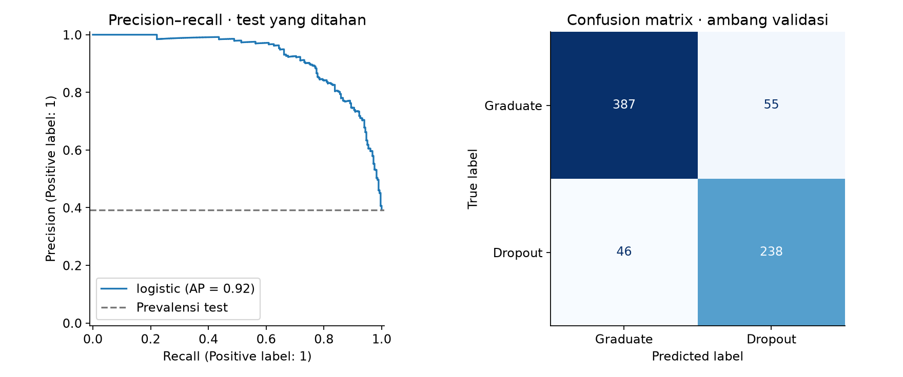
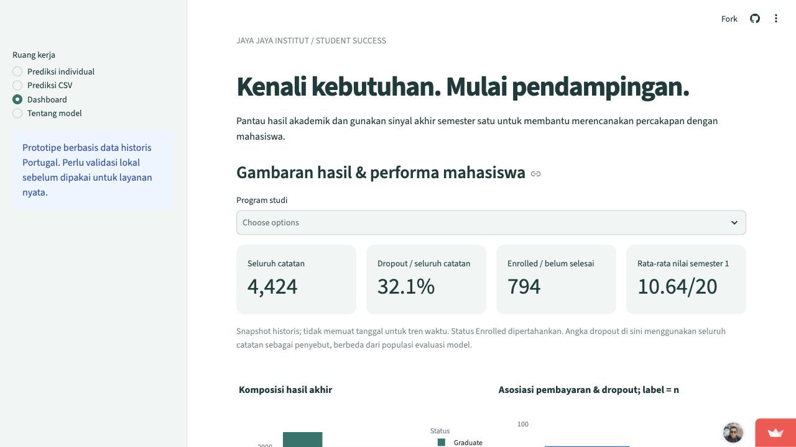

# Proyek Akhir: Menyelesaikan Permasalahan Perusahaan Edutech

## Jaya Jaya Institut · Early warning akhir semester satu

**Proyek referensi independen, dibuat dengan AI untuk pembandingan dengan karya mandiri.** Identitas peserta tidak diisi atau diatasnamakan. Struktur mengikuti [templat resmi Dicoding](https://github.com/dicodingacademy/a590-Belajar-Penerapan-Data-Science/tree/a590_proyek_akhir/a590_proyek_akhir); salinan sumber berada dalam `template_original/`.

**Repository referensi:** [lfiathan/jaya-reference](https://github.com/lfiathan/jaya-reference).

**Status:** analisis, notebook, model, prototipe lokal/cloud, dan dashboard tersedia. **[Buka prototipe publik](https://jaya-reference-lfiathan.streamlit.app/)** — akses tanpa login, prediksi individual, serta empat layar aplikasi telah diverifikasi pada 15 November 2026 (Asia/Jakarta). Status dan bukti tersimpan dalam `deployment.json` serta `reports/cloud_*.png`. Naskah video tersedia; rekaman video opsional belum dibuat.

## Business Understanding

Jaya Jaya Institut adalah institusi fiktif yang ingin mengurangi mahasiswa putus studi melalui deteksi kebutuhan pendampingan. Proyek mengubah indikator akademik menjadi informasi bagi pembimbing untuk meninjau dan menawarkan dukungan. Dataset publik berasal dari Portugal, sehingga bukan bukti mengenai mahasiswa nyata Jaya Jaya atau populasi Indonesia.

### Permasalahan Bisnis

1. Berapa proporsi dropout historis dan bagaimana komposisi status mahasiswa?
2. Bagaimana indikator akademik, pembayaran, dan beasiswa berasosiasi dengan dropout?
3. Dapatkah data yang tersedia sampai akhir semester satu memprioritaskan mahasiswa untuk ditinjau pembimbing?

### Cakupan Proyek

- Analisis seluruh **4.424 catatan** untuk dashboard deskriptif.
- Model klasifikasi biner **Dropout (1) vs Graduate (0)** pada **3.630 outcome selesai**. **794 Enrolled** tidak diberi label negatif karena outcome akhirnya belum diketahui. Dashboard tetap memuat Enrolled.
- Waktu keputusan model: **setelah semester satu**, bukan saat penerimaan. Model memakai 10 fitur: Course, Daytime/evening attendance, Previous qualification grade, Admission grade, dan enam indikator semester satu.
- Semester dua, identitas, demografi, finansial, dan ekonomi tidak menjadi input model. Waktu pencatatan finansial tidak cukup jelas untuk menjamin ketersediaannya saat early warning.
- Prototipe memberi sinyal tinjauan, bukan keputusan otomatis. Efektivitas pendampingan dan penurunan dropout belum diuji.

Target desain usulan adalah **recall dropout ≥80% pada validation**, lalu memaksimalkan precision untuk membatasi beban tinjauan. Target ini perlu dibahas dengan institusi; bukan janji kinerja dan tidak dipaksakan pada test.

### Persiapan

Sumber data: [Dicoding students' performance](https://github.com/dicodingacademy/dicoding_dataset/blob/main/students_performance/README.md), [CSV resmi](https://raw.githubusercontent.com/dicodingacademy/dicoding_dataset/main/students_performance/data.csv).

Sumber asli: Realinho, V., Vieira Martins, M., Machado, J., & Baptista, L. (2021). *Predict Students' Dropout and Academic Success*. UCI Machine Learning Repository. [DOI: 10.24432/C5MC89](https://doi.org/10.24432/C5MC89), CC BY 4.0. Kamus kolom disalin pada `data/DATA_DICTIONARY.md`. Nama kolom CSV mengikuti versi Dicoding (underscore dan label `Status`).

SHA256 berkas CSV:

```text
a37dbda5555089a8d39b8be6f1a242f68403963a1f81423115c9676c8c7100e9
```

Audit aktual: 4.424 baris, 37 kolom, 0 missing cell, 0 duplikasi seluruh baris. Karena tidak ada ID mahasiswa, ketiadaan duplikasi baris tidak membuktikan setiap individu hanya muncul sekali. Tidak ada tanggal/kohort yang mendukung validasi temporal.

Setup environment, dari folder proyek yang telah diekstrak (Python **3.12**):

```bash
python3.12 -m venv .venv
source .venv/bin/activate
python -m pip install -r requirements-dev.txt
```

Untuk hanya menjalankan prototipe, cukup `requirements.txt`. Seluruh versi runtime utama dipasang persis seperti environment pengujian; model joblib membutuhkan versi scikit-learn yang sesuai.

Jalankan ulang training dan pengujian:

```bash
python -m src.train
python -m unittest discover -s tests -v
```

Notebook `notebook.ipynb` sudah dieksekusi dan menyimpan output. Untuk menjalankan ulang, pilih kernel dari environment proyek di Jupyter/VS Code. Skrip opsional:

```bash
python -m ipykernel install --prefix /tmp/jaya-jupyter --name jaya-reference
JUPYTER_PATH=/tmp/jaya-jupyter/share/jupyter python execute_notebook.py
```

### Metode dan hasil evaluasi

Pemisahan stratified dengan seed 42: **2.178 train, 726 validation, 726 test**, di luar 794 Enrolled. Daftar indeks disimpan dalam `reports/split_indices.json`. Median imputation, standard scaling numerik dan one-hot kategori dilakukan dalam pipeline yang di-fit hanya pada train/fold.

Pemilihan model menggunakan **5-fold stratified cross-validation pada train**, berdasarkan Average Precision (AP). AP digunakan sebagai ringkasan kurva precision–recall, bukan luas trapezoid PR.

| Kandidat | Mean CV AP | Std CV AP |
|---|---:|---:|
| Dummy prior | 0,3916 | 0,0007 |
| **Logistic regression** | **0,9089** | **0,0074** |
| Random forest | 0,8968 | 0,0109 |
| Histogram gradient boosting | 0,9001 | 0,0101 |

Ambang **0,4557202141** dipilih hanya pada validation: precision tertinggi yang masih mencapai recall ≥0,80. Validation menghasilkan recall 80,28% dan precision 83,52%. Setelah itu model dan ambang dibekukan untuk test, tanpa refit ke test atau seluruh data. Artefak deployment identik dengan model yang dievaluasi.

| Metrik pada test | Model terpilih | Dummy prior pada ambang 0,5 |
|---|---:|---:|
| AP | 0,9207 | 0,3912 |
| ROC-AUC | 0,9362 | 0,5000 |
| Recall dropout | 83,80% | 0,00% |
| Precision dropout | 81,23% | 0,00% |
| F1 | 0,8250 | 0,0000 |
| F2 | 0,8328 | 0,0000 |
| Balanced accuracy | 0,8568 | 0,5000 |
| Brier score, lebih rendah lebih baik | 0,0944 | 0,2382 |

Dummy memakai prior probabilitas konstan; AP-nya sama dengan prevalensi dropout test. Precision dummy bernilai 0 menurut konvensi evaluasi karena tidak memprediksi positif pada ambang 0,5.

| Aktual \ Prediksi | Graduate / rutin | Dropout / tinjau |
|---|---:|---:|
| Graduate | 387 | 55 |
| Dropout | 46 | 238 |

Pada 726 catatan test, **293** ditandai untuk tinjauan: 238 true positive dan 55 false positive. **46** dropout terlewat. Beban dan jumlah ini berasal dari sampel test, bukan proyeksi mahasiswa aktif.

Interval bootstrap 95%, 1.000 resample pada test dengan model tetap: AP **0,8986–0,9441**, recall **79,62–88,42%**, precision **77,54–85,67%**. Interval tidak memasukkan semua variasi pemilihan model dan training.



Permutation importance pada validation menempatkan unit lulus semester satu sebagai sinyal prediktif terkuat. Hasil lengkap mean/std tersimpan pada `reports/permutation_importance.csv`. Importance bukan efek kausal atau penjelasan pasti untuk mahasiswa individual; korelasi antarfitur dapat memengaruhi nilainya.

## Business Dashboard

Dashboard utama dibuat di **Metabase**. Akses lokal pembuat: [Student Success Overview](http://localhost:3300/dashboard/2). Tautan localhost hanya dapat diakses pada komputer yang menjalankan servicenya.

**Akun reviewer khusus instance referensi lokal:**

- Email: `root@mail.com`
- Password: `Root123!reference`

Password ini merupakan akun demonstrasi untuk database publik proyek, bukan kredensial akun pribadi. Metabase yang mengekspor H2 dipatok ke versi `metabase/metabase:v0.56.3` agar pemulihan menggunakan versi identik.

Dashboard berisi 10 kartu:

1. Total 4.424 mahasiswa.
2. Dropout / seluruh catatan: **32,12%**.
3. Enrolled, outcome belum selesai: **794**.
4. Rata-rata nilai semester satu: **10,64 / 20**.
5. Grafik komposisi status.
6. Grafik persentase dropout menurut status pembayaran.
7. Grafik rata-rata unit lulus semester satu menurut status.
8. Grafik persentase dropout menurut status beasiswa.
9. Grafik ukuran kelompok pembayaran.
10. Grafik ukuran kelompok beasiswa.

Persentase kelompok memakai penyebut seluruh catatan kelompok, termasuk Enrolled. Sumbu grafik persentase 0–100, jumlah dan unit dimulai dari nol. Ukuran kelompok disajikan tersendiri untuk mencegah pembacaan persentase tanpa konteks.

Hasil query terverifikasi tersimpan dalam `dashboard/dashboard_manifest.json`. File ekspor **`dashboard/metabase.db.mv.db`** memuat dashboard, saved questions, konfigurasi dan akun Metabase. File **`dashboard/students.sql`** adalah dump PostgreSQL berisi tabel sumber; H2 saja tidak menyertakan data PostgreSQL eksternal.

### Memulihkan dashboard pada komputer reviewer

Prasyarat: Docker Desktop aktif, environment Python proyek, dan port 3301 serta 55433 tersedia. Skrip membuat **container baru**, menolak menimpa container bernama sama, memulihkan kedua database, menghubungkan sumber data, lalu menjalankan seluruh query dan membandingkannya dengan hasil ekspor.

```bash
python dashboard/restore_dashboard.py
```

Sesudah berhasil, buka [dashboard hasil pemulihan](http://localhost:3301/dashboard/2) dan login dengan akun di atas. Bukti pemulihan berada dalam `dashboard/restore_verification.json`. Untuk membuka kembali instance yang pernah dipulihkan:

```bash
docker start jaya-review-postgres jaya-review-metabase
```

Untuk menghentikannya tanpa menghapus data:

```bash
docker stop jaya-review-metabase jaya-review-postgres
```

Tidak diperlukan link Metabase publik karena artefak dashboard disediakan melalui ekspor instance dan prosedur restore. Aplikasi Streamlit juga memuat dashboard visual dengan filter program studi sebagai tampilan tambahan. Keduanya memakai snapshot data publik; belum merupakan pemantauan data produksi langsung dan tidak mengarang tren waktu tanpa tanggal.

## Menjalankan Sistem Machine Learning

Jalankan dari folder proyek:

```bash
source .venv/bin/activate
streamlit run app.py
```

Buka alamat lokal yang muncul, biasanya [http://localhost:8501](http://localhost:8501). Aplikasi memuat pipeline, fitur dan ambang dari `model/dropout_model.joblib`; tidak melatih model saat pengguna mengisi formulir.

- **Prediksi individual:** pilih program studi/waktu kuliah, isi nilai dan indikator semester satu, lalu klik *Lihat sinyal pendampingan*.
- **Prediksi CSV:** unduh contoh format; unggah CSV berkoma berisi 10 kolom numerik yang sama. Maksimum 10.000 baris. Hasil mempertahankan urutan baris dan dapat diunduh.
- **Dashboard:** grafik komposisi, pembayaran, unit lulus, dan dropout menurut program dengan filter program studi.
- **Tentang model:** hasil test, definisi populasi, waktu prediksi, dan keterbatasan.

Skala nilai kualifikasi/penerimaan **0–200**, skala semester **0–20**. Jumlah unit/evaluasi nonnegatif dan integer. Input kosong, tak hingga, kolom hilang, skala salah dan kode program tidak dikenal ditolak. Nilai di luar pola training yang masih lolos rentang tetap berisiko menghasilkan prediksi yang buruk. Credit transfer dapat menyebabkan unit lulus melebihi unit diambil pada data sumber, sehingga hubungan itu tidak otomatis ditolak.

Skor bukan kepastian atau probabilitas yang sudah tervalidasi untuk semua mahasiswa aktif. Data Enrolled tidak memiliki label akhir; penerapan model outcome selesai kepada mahasiswa aktif memerlukan validasi prospektif. Data unggahan tidak ditulis ke disk oleh aplikasi. Model hanya boleh dimuat dari artefak training yang dipercaya.

### Streamlit Community Cloud

**URL publik aktif: [Jaya Jaya Student Success](https://jaya-reference-lfiathan.streamlit.app/).** Dideploy dari `lfiathan/jaya-reference`, branch `main`, file `app.py`, Python 3.12. Akses tanpa login dan empat layar telah diperiksa. Contoh profil Management menghasilkan skor **44,5%**, sesuai model lokal, dengan pesan pendampingan rutin. Detail dan batas pengujian berada di `deployment.json`.



Langkah berikut mendokumentasikan cara mereproduksi deployment:

1. Gunakan repository GitHub proyek ini atau fork terpisah. Paket aplikasi minimum adalah `app.py`, `src/`, `model/`, `data/`, `reports/metrics.json`, `requirements.txt`, dan `.streamlit/config.toml`. `.venv/` tidak diunggah.
2. Login ke [Streamlit Community Cloud](https://share.streamlit.io/). Otorisasi akun/akses repository ditangani pemilik akun.
3. Pilih **Create app**, repository/branch yang sesuai, dan file `app.py` di root. Pada Advanced settings pilih **Python 3.12**. Tidak memerlukan secrets untuk dataset publik ini.
4. Tunggu instalasi dan pastikan aplikasi dapat membuat prediksi serta menampilkan dashboard tanpa error.
5. Buka URL aktual dari sesi tanpa login; pastikan reviewer dapat mengakses. Simpan URL yang terverifikasi pada README dan `deployment.json`, lalu ubah status hanya setelah berhasil.

Petunjuk mengikuti [dokumentasi deployment resmi Streamlit](https://docs.streamlit.io/deploy/streamlit-community-cloud/deploy-your-app/deploy). Petunjuk deployment tidak menggantikan bukti aplikasi cloud yang hidup.

## Conclusion

1. **Besarnya masalah:** 1.421 dari 4.424 catatan berstatus Dropout (**32,12%**), 2.209 Graduate, dan 794 Enrolled. Pada subset outcome selesai, prevalensi dropout adalah **39,15%**; kedua penyebut tidak boleh dipertukarkan.
2. **Indikator monitoring:** rata-rata unit lulus semester satu adalah **2,55** pada Dropout, **4,32** pada Enrolled dan **6,23** pada Graduate. Dropout pada pembayaran belum mutakhir **86,55% (n=528)** versus mutakhir **24,74% (n=3.896)**. Pada penerima beasiswa **12,19% (n=1.099)** versus bukan penerima **38,71% (n=3.325)**. Semua adalah asosiasi observasional, bukan bukti sebab-akibat.
3. **Solusi prediktif:** logistic regression berbasis semester satu menghasilkan AP test **0,9207**, recall **83,80%** dan precision **81,23%**. Model dapat digunakan sebagai prototipe untuk demonstrasi prioritas tinjauan.
4. **Batas kesimpulan:** belum ada bukti penurunan dropout akibat intervensi, belum ada validasi temporal/prospektif atau kalibrasi pada mahasiswa aktif, dan belum ada validasi lokal Indonesia. Identitas dan tanggal tidak tersedia untuk menguji pengulangan individu atau pergeseran kohort. Audit per kelompok belum dilakukan, sehingga tidak ada klaim kesetaraan kinerja.

### Rekomendasi Action Items

| Tindakan | Penanggung jawab usulan | Waktu usulan | Ukuran keberhasilan |
|---|---|---|---|
| Pilot tinjauan sukarela atas sinyal model, verifikasi data, dan tawarkan pendampingan | Kepala program & dosen pembimbing | Setelah semester satu; kontak awal ≤7 hari kerja | Proporsi kandidat terhubung, kebutuhan terverifikasi, rencana pendampingan selesai |
| Tutor, klinik belajar, atau penyesuaian rencana studi bagi yang mengalami hambatan akademik | Tim akademik | Semester berikutnya | Partisipasi, unit lulus, kelanjutan studi; bandingkan dengan baseline yang sesuai |
| Konsultasi pembayaran/beasiswa berdasarkan kebutuhan yang dikonfirmasi | Layanan keuangan | Saat tinjauan | Penyelesaian rencana dukungan; bukan pembatasan akses berdasarkan skor |
| Kumpulkan snapshot bertanggal dan outcome kohort baru; audit drift, kalibrasi, recall/precision per kelompok | Tim data | Audit bulanan; evaluasi per kohort | Kualitas data, false negative, false positive, beban tinjauan dan kesenjangan kinerja |
| Evaluasi dampak program dengan desain terkontrol yang sesuai dan tata kelola | Pimpinan & tim evaluasi | Setelah outcome kohort tersedia | Retensi dan kesejahteraan mahasiswa; nyatakan efek hanya jika didukung bukti |

### Bukti dan peta artefak

| Artefak | Isi |
|---|---|
| `notebook.ipynb` | Seluruh tahapan, Markdown penjelas, kode dan output hasil eksekusi |
| `reports/metrics.json` | Provenance, CV, threshold, evaluation dan interval bootstrap |
| `reports/test_predictions.csv` | Prediksi test untuk menghitung ulang metrik |
| `reports/split_indices.json` | Indeks train/validation/test/unresolved yang tidak tumpang tindih |
| `model/dropout_model.joblib` | Pipeline preprocessing + classifier + fitur + ambang |
| `app.py` | Prototipe Streamlit dan dashboard tambahan |
| `dashboard/` | H2 Metabase, dump PostgreSQL, query manifest, skrip build/restore |
| `tests/test_project.py` | Separation, kesetaraan prediksi artefak, validasi input dan alur aplikasi |
| `reports/test_log.txt` | Hasil pengujian integrasi |
| `reports/notebook_execution.txt` | Status eksekusi notebook |
| `deployment.json` | URL publik, environment cloud dan hasil verifikasi anonim |
| `VIDEO_SCRIPT.md` | Naskah video opsional ±4 menit, bukan rekaman |
| `COMPARISON.md` | Tempat pembandingan setelah karya mandiri tersedia |

### Pemenuhan kriteria saat ini

| Kriteria | Status referensi |
|---|---|
| 1. Templat dan Markdown | Tersedia; struktur sumber disertakan |
| 2. Seluruh proses sampai deployment | Tahapan lengkap terdokumentasi; prototipe cloud dan akses anonim terverifikasi |
| 3. Dashboard visual dan akses/ekspor | Metabase + kedua database disertakan; login dan prosedur restore tersedia |
| 4. Solusi ML Streamlit + Community Cloud | Prototipe lokal/cloud teruji; URL publik dan cara menjalankan tercantum |
| 5. Rekomendasi action items | Tersedia, terkait temuan dan batas bukti |

Referensi ini tidak menjanjikan nilai reviewer. Pembandingan dengan karya mandiri belum dilakukan karena karya tersebut belum diberikan.
